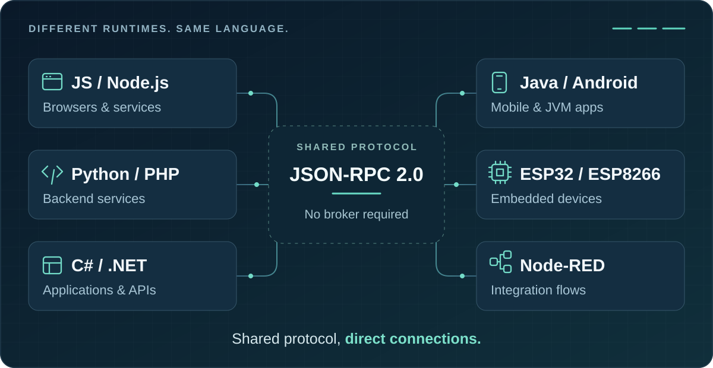

# RPC Toolkit

**Different languages. Connected systems.**

Connect services, apps and embedded devices with a common JSON-RPC 2.0 protocol.
Choose the library for your runtime; endpoints communicate directly, without a
central RPC Toolkit service.

[Get started](docs/GETTING_STARTED.md) · [Documentation](https://n-car.github.io/rpc-toolkit/) · [Releases](docs/RELEASES.md)

## Choose your runtime

Go straight to the implementation for API reference, examples and installation details.

| Your environment | Library |
| --- | --- |
| Node.js | [Express](https://github.com/n-car/rpc-express-toolkit) · [Standalone Node](https://github.com/n-car/rpc-node-toolkit) |
| Browser / JavaScript client | [JS client](https://github.com/n-car/rpc-toolkit-js-client) |
| C# / .NET / ASP.NET Core | [.NET toolkit](https://github.com/n-car/rpc-dotnet-toolkit) |
| Java / Android | [Java toolkit](https://github.com/n-car/rpc-java-toolkit) |
| Python | [Python toolkit](https://github.com/n-car/rpc-python-toolkit) |
| PHP | [PHP toolkit](https://github.com/n-car/rpc-php-toolkit) |
| Arduino / ESP32 / ESP8266 | [Arduino toolkit](https://github.com/n-car/rpc-arduino-toolkit) |
| Node-RED | [Node-RED nodes](https://github.com/n-car/node-red-contrib-rpc-toolkit) |

## Start simple, add what you need

- **Standard JSON-RPC:** calls, notifications, batches and structured errors.
- **Discoverable endpoints:** optional method discovery and schema metadata where supported.
- **Type-aware payloads:** optional Safe Mode for dates, large integers and unambiguous strings.

Host APIs and supported features vary by runtime. Safe Mode is not authentication
or encryption; see the [compatibility matrix](docs/COMPATIBILITY.md) and
[security model](docs/SECURITY_MODEL.md).

## Tested across runtimes

The **2026-10-12** HTTP validation passed **36/36 scenarios and 540 checks** across
six service runtimes. Separate Android/ESP32 and Node-RED checks are documented
with their scope and limits in the [validation notes](docs/VALIDATION.md).

## Explore the ecosystem

- [Overview](docs/OVERVIEW.md) — use cases and design choices.
- [Getting started](docs/GETTING_STARTED.md) — a first call and package installation.
- [Introspection](docs/INTROSPECTION.md) and [Safe Mode](docs/SAFE_MODE.md) — optional capabilities.
- [Releases](docs/RELEASES.md) and [roadmap](docs/ROADMAP.md) — what ships and what is planned.

This repository is the documentation hub, not a package to install.
[Contributions](CONTRIBUTING.md) are welcome. [MIT license](LICENSE).
